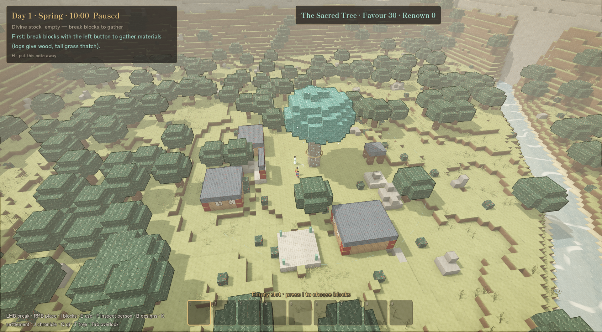
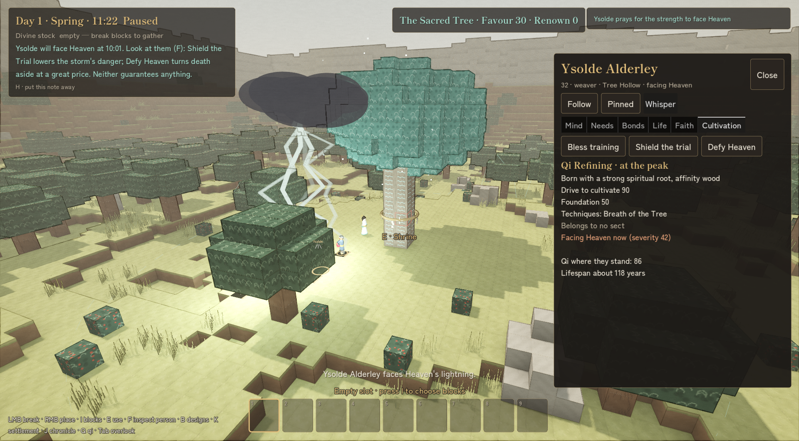

# The Bound God

*You are the spirit of an ancient sacred tree. The people beneath your branches will become a sect. You cannot tell them what to do.*



The Bound God is a third-person voxel game about nurturing a cultivation sect you do not control. You walk the land beneath your tree as a robed jade avatar. Mortals who meditate in its shade find that cultivation comes easier, so they stay, teach, build and in time found a sect of their own. You shape the ground, offer them designs, whisper to them and spend scarce Favour on blessings and the occasional miracle. They choose their own masters, their own buildings and their own quarrels, and they keep living while you meditate through the years.

When a cultivator faces a heavenly tribulation beneath your branches, the tree learns from it. Over generations the sect's struggles shape what the tree becomes, and the tree's growth shapes what the sect can become.

## What you do

- **Walk and build inside your presence.** Your avatar is bound to the zone around the shrine it is manifested at. Inside it you can break and place blocks, fill a chest with materials, kindle a hearth or open the shrine menu at the tree.
- **Offer designs, never orders.** Build a cottage, a hall or a meditation room with your own hands, capture it as a template and offer it at a shrine. Lay a blueprint where you would like something raised. People who need that kind of building may take the idea up, or may not.
- **Read minds.** Inspect anyone to see what they want, what they believe, what they tried and why they changed course. Every decision is logged with its reason.
- **Whisper, bless, protect.** Favour comes from prayer and is scarce. A whisper nudges one believer for a day. A blessing improves someone's odds. Shielding a tribulation lowers its danger, and Defying Heaven can turn death aside at a great price. Nothing you do grants a realm.
- **Watch cultivators rise.** People are born with talent (or without), cultivate in the tree's qi, teach students, attempt breakthroughs and face Heaven's lightning. Some survive with a sound foundation, some are injured, some die.
- **Let the tree grow.** Each tribulation teaches the tree. Insights unlock spirit fruit and nurtured cultivation spots, which in turn change what the sect can do and what it argues about.
- **Meditate through years.** Rest for days, seasons or years. The world does not pause: the sect recruits, builds, splits and buries its elders. Important events wake you, and the chronicle tells you what happened and why.
- **Spread through belief.** Believers carry your name to other places and raise shrines there. Each active shrine is somewhere you can manifest. Lose them all and the god goes dormant until people restore an altar. There is no game-over screen.



## Design pillars

| Pillar | In practice |
| --- | --- |
| Influence, not obedience | No feature commands a person, assigns a job or chooses a leader. |
| A world that continues without you | Settlements and sects keep simulating while you are elsewhere or meditating. |
| Individuals across generations | A novice met today may be an elder in a century. |
| Mutual growth | The tree's qi helps cultivators advance; their tribulations teach the tree. |
| A tangible, editable world | A structure's function comes from its components, never from its name. |
| Reach is earned through belief | The avatar exists only where people worship. |
| Divinity has an opportunity cost | One great rescue can cost what would have nurtured ten disciples. |
| Every outcome has a reason | Each person's "why" is inspectable; the chronicle records causes. |

## Where it stands

Version 1.0.0. The original vertical slice (voxel valley, templates, people with minds of their own, faith, shrines, miracles, food, threats, saves) is built, and so is the cultivation slice: qi, cultivators and realms, breakthroughs and lightning tribulations, the tree's insights and unlocks, meditation over years with a chronicle, and a sect that founds itself and raises its own halls (libraries, seclusion rooms, thunder chambers, infirmaries, mountain gates and more). Seasons and weather, herbs and alchemy, branches and regions, other sects and outsiders, the campaign shape (ages, deeds and an epilogue), and the look, sound and feel are built too.

The 1.0.0 Windows build is made and passes its smoke test; it has not been published. What it still needs is people: a closed beta, fresh-player playtests and play by hand. `PROGRESS.md` records what is built in detail.

## Controls

Keyboard and mouse, with gamepad support. Keys and pad buttons can be rebound in Settings.

| Action | Key |
| --- | --- |
| Move / jump / sprint | WASD or arrows / Space / Shift |
| Break / place block | Left mouse / right mouse |
| Rotate block | R |
| Choose hotbar slot | 1–9, mouse wheel |
| Use the block under the crosshair | E |
| Inspect a person | F |
| Blocks and hotbar | I |
| Design tool and library | B |
| Overlook camera | Tab |
| Settlement panel / chronicle | K / J |
| Qi overlay / tree screen | Q / T |
| Pause / slower / faster | P / , / . |
| Put the guide note away | H |
| Quick save / fullscreen | F5 / F11 |
| Pause menu | Esc |

## Running it

The game is built with **Godot 4.2.2** (GDScript, Forward+ renderer) and runs on **Windows** only; there is no web build.

```powershell
.\Run.ps1                                  # play, using the installed Godot 4.2.2 editor
.\Run.ps1 -GodotExe 'C:\path\to\Godot.exe' # use a different Godot 4.2.2 executable
```

Or open `project.godot` in the Godot 4.2.2 editor and press Play.

The game uses the shared WebHatchery Godot toolkit (`../godot_toolkit`) as `res://addons/hatchery/`. After cloning, link it once (a directory junction, not committed here):

```powershell
..\godot_toolkit	ools\Link-Toolkit.ps1 -ProjectDir .
```

### Checks

The simulation is deterministic and runs headless, so its scenarios are checked without a window:

```powershell
$godot = 'C:\Program Files\Godot\Godot_v4.2.2-stable_mono_win64_console.exe'
& $godot --headless --path . --script res://tools/sim_checks.gd   # simulation scenarios, PASS/FAIL
& $godot --headless --path . --editor --quit                      # parse and import check
```

Visual changes are verified with in-game captures written to `docs/verification/` (see `PROGRESS.md` for the capture command).

### Building and publishing

`publish.ps1` (the shared toolkit publisher) exports the Windows build and deploys it with a download page; `-BuildOnly` only builds and `-DryRun` changes nothing. `publish-itch.ps1` pushes the last build to itch. Exports need the standard (non-mono) Godot 4.2.2 console editor that matches the installed export templates.

## How it is built

- **The simulation** (`scripts/agents`, `scripts/sim`, `scripts/world`, `scripts/building`) is plain `RefCounted` data and logic. It never touches the scene tree, draws all randomness from one seeded RNG and is deterministic from the seed. Long meditations run an abstract settlement model so years pass in seconds.
- **The people** are a GDScript port of the BDI (belief, desire, intention) agent system from Final Landing: utility-scored goals with reasons, committed intentions, ranked plans with fallbacks, failure learning, decaying beliefs, gossip and typed messages. Agents never change the world directly; they push effects applied at the end of each tick.
- **Presentation** (`scripts/presentation`) reads simulation state and sends commands. The voxel world is meshed from 16³ chunks on the worker thread pool.
- **Data** lives in validated JSON catalogs under `data/` (blocks, templates, people, miracles, cultivation, tribulations, the tree, balance numbers and all player-facing text). Missing or mistyped data stops the game at startup with an error screen.
- **Saves** go under `user://` with staged writes, backups and schema checks. Shared templates are versioned JSON and are validated as untrusted on import.

| Path | Contents |
| --- | --- |
| `scenes/` | Title and main scenes |
| `scripts/` | Simulation, agents, building, presentation and core (data, validation, saves, settings) |
| `data/` | Catalogs, balance and text |
| `assets/` | Block atlas, fonts, shaders, UI theme and icon |
| `tools/` | Headless checks, profiling and atlas tools (excluded from the export) |
| `addons/hatchery/` | The shared toolkit, linked from `../godot_toolkit` (not committed) |
| `docs/` | Design notes, art direction, playtests and verification captures (not imported by Godot) |

## Documents

- [`GAME_DESIGN.md`](GAME_DESIGN.md): the design, with its decisions, leanings and open questions
- [`PROGRESS.md`](PROGRESS.md): what is built, decisions taken while building, known issues
- [`AGENTS.md`](AGENTS.md): conventions and invariants for anyone working on the code
- [`docs/design/`](docs/design/): art and font direction
- [`docs/reference/`](docs/reference/): architecture notes and the Final Landing NPC system the people are ported from

## Promoter capture

Promoter uses the shared [Godot capture driver](../godot_toolkit/tools/promo/README.md); this project does not need its own capture script. Capture normal routes from the game's title screen and use its documented controls to stage publicly released features. See the [Promoter plan and update rules](../../local_apps/promoter/adapters/godot/README.md).

From this project root, check whether source changes need an update video:

```powershell
$promoter = (Resolve-Path '..\..\local_apps\promoter').Path
$project = (Resolve-Path '.').Path
& "$promoter\scripts\godot-promo.ps1" -Mode status -ProjectRoot $project -ProjectKey bound-god
```

Keep `bound-god` as the project key for later videos. Put plans and generated media under Promoter's ignored `data/media/` directory.

Promo recording uses the shared launcher on a private Windows desktop with an isolated save/settings profile. `--promo-background` keeps pointer state logical: gameplay controls work without asking Windows to capture or confine the desktop mouse. Put the normal New World click in the plan's `setupActions` and allow world generation to finish with `settleFrames` before the gameplay shots. Keep using the shared driver rather than a copied temporary capture script. Recording uses real-time inputs and background image encoding; normal play keeps its existing display settings. See Promoter's adapter notes for performance reports and capture limitations.
